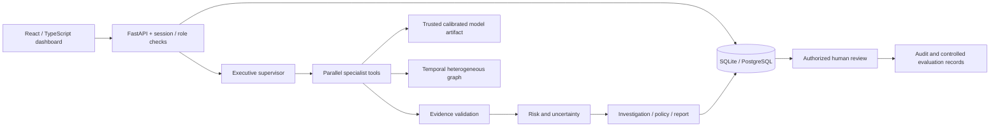
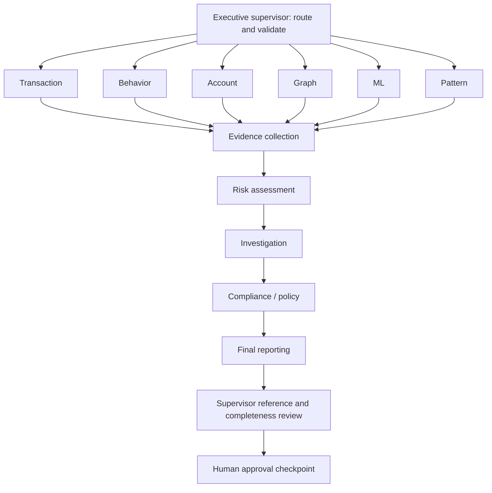
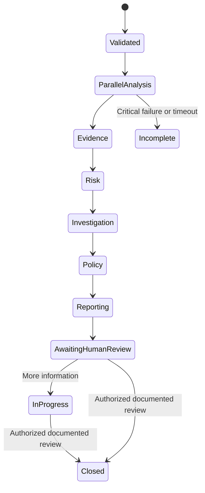
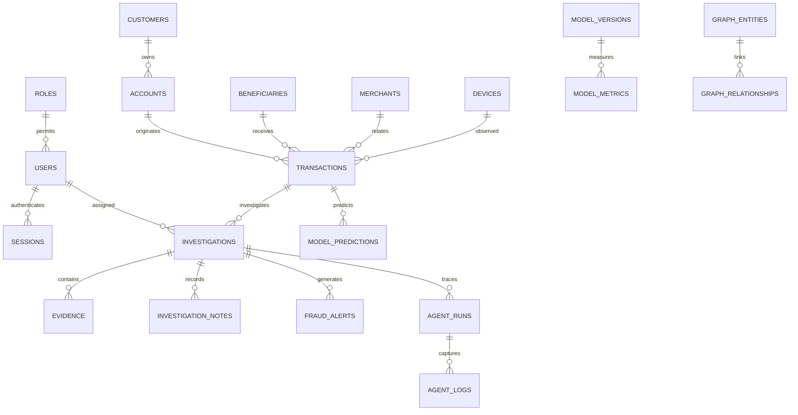

# Architecture

The framework uses an explicit typed state machine, the allowed local alternative to LangGraph. No chatbot API participates in scoring. Agent tools receive snapshots of authorized transaction data and can return structured evidence; they cannot issue SQL, call external services or execute banking actions.

Incoming events are validated and persisted, then explicitly analyzed via API or demo command. Core analysis is synchronous, with independent local tools in a thread pool. Supervisor checks every output against `AgentResult`, verifies referenced transaction IDs exist in the temporal snapshot and rejects missing provenance/uncertainty. Dependent stages receive only validated results. Missing specialists lower coverage/confidence and appear in policy checks; missing evidence or risk aborts the dependent flow. Every run has an overall deadline, retry bound and maximum attempts. Python native tool threads cannot be forcibly killed; hard process isolation is future work.

Graph entities include accounts, synthetic customer ownership, transactions, beneficiaries, merchants and devices. A beneficiary account identifier in a simulator is treated as an observed destination identity, not independent proof of ownership. Verified shared identifiers and IP addresses are deliberately absent because the dataset does not provide authorization or verification. Each relationship carries transaction ID, source, amount and event timestamp. API graph snapshots are reconstructed from persisted transaction records; `build_graph.py` also persists entities/relationships for inspection. Graph is a derived view of relational evidence, not a second authoritative ledger.

There is no transition that moves money, restricts access or contacts an authority. Review records identity, timestamp, rationale, outcome, decision, policy and evidence IDs. Synthetic historical labels are immutable under review.

